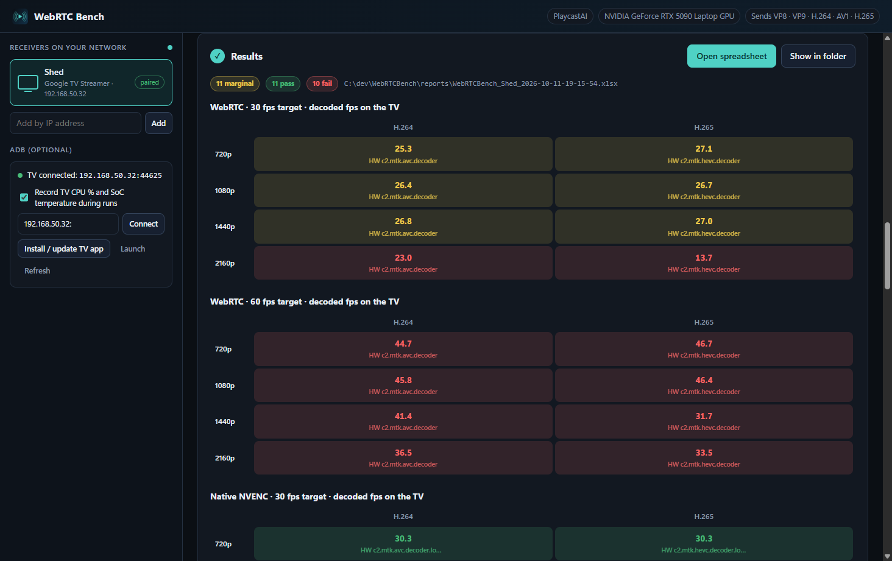
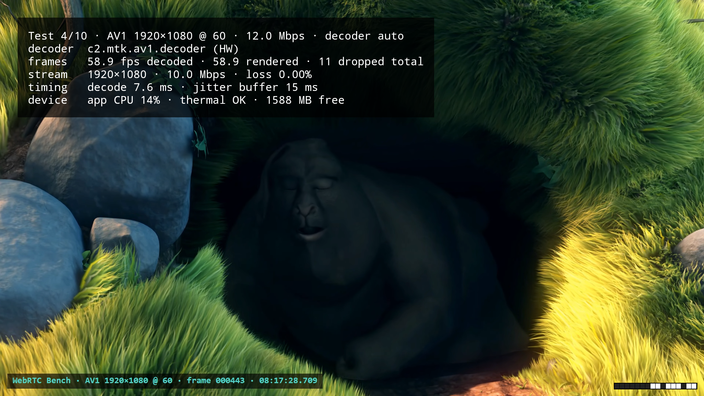
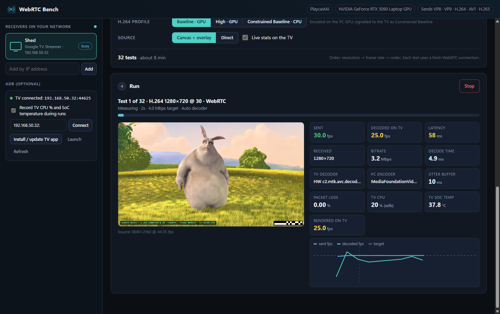
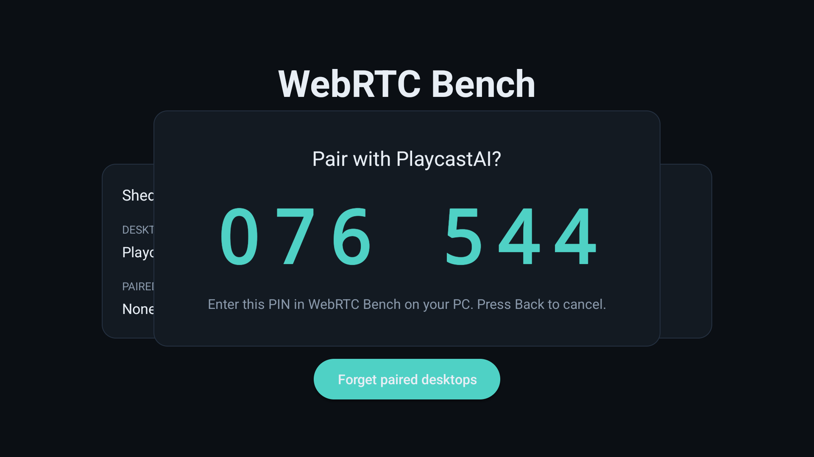
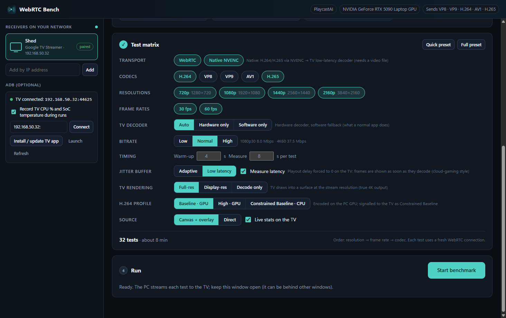
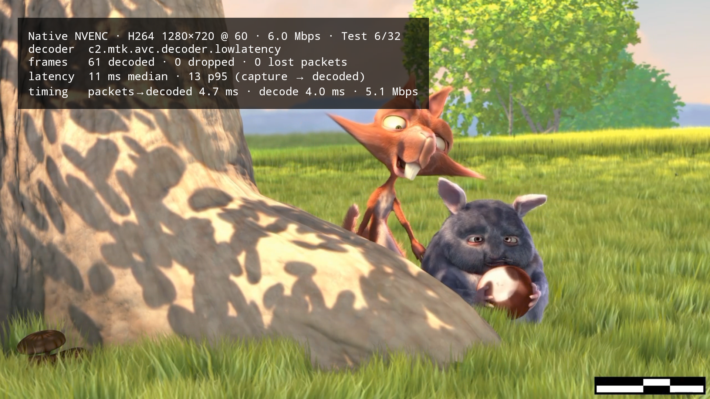

# WebRTC Bench

Measures how fast and how smoothly Android TV devices (tested: Google TV Streamer, Fire TV) can
receive video streamed from a Windows PC, the way cloud gaming and screen mirroring do. The PC
app finds the TV on the LAN, pairs with a PIN, streams a test video through a matrix of
**codecs × resolutions × frame rates** and writes a formatted **.xlsx** report with decoded fps,
per-frame latency (capture on the PC → decoded, and → on screen) and TV device stats.

Three ways to stream, compared side by side:

* **Standard WebRTC**: Chromium's WebRTC to the TV's WebRTC library, as a browser or stock app does it.
* **Cloud-gaming WebRTC**: still WebRTC on the wire, but frames come from NVENC directly and the TV
  decodes straight to the screen with no jitter buffer.
* **Native**: NVENC → RTP/UDP → low-latency MediaCodec, the lower bound on this hardware.

Plus a **screen probe** that times PC screen → TV screen for any mirroring path, Miracast included.

At 1080p60, capture → decoded on the TV: standard WebRTC 160–177 ms, cloud-gaming WebRTC
16.6–16.9 ms, native 11.0–11.2 ms. Full tables in [docs/results.md](docs/results.md).

| PC app | TV app |
|---|---|
|  |  |
|  |  |
|  |  |

## Documentation

| | |
|---|---|
| [How it works](docs/how-it-works.md) | Test procedure, verdicts, transports and profiles, frame pacing, mirroring, screen probe, options, report sheets |
| [Running benchmarks](docs/benchmarking.md) | Unattended runs and every CLI flag, the scripts behind the published results, Miracast, troubleshooting |
| [Results](docs/results.md) | Measured numbers for both TVs and what they mean ([charts](docs/tv-bench-results.html)) |
| [Protocol](docs/protocol.md) | Discovery, control messages, native side channel, wbsend → desktop frame format |

## Repository layout

```
desktop/   Electron app: sender, test runner, report writer
native/    wbsend.exe: native NVENC + RTP/UDP sender (C++)
android/   TV app (receiver): Kotlin + io.github.webrtc-sdk:android
tools/     Benchmark-set scripts, comparison report, icon generator
docs/      Documentation, results charts, screenshots
videos/    Benchmark clip library (marker file .webrtcbench; clips are downloaded, not in git)
```

Not in git, created locally: `WebRTCBench-TV.apk` (TV build used by the desktop "Install / update
TV app" button), `native/build/`, `release/` (packaged desktop app), `reports/` (spreadsheets and
raw JSON).

## Quick start

1. **Install the TV app.** Either click *Install / update TV app* in the desktop app's ADB panel
   (the TV must be connected with `adb connect <ip>:<port>`), or run:

   ```
   adb install -r WebRTCBench-TV.apk
   ```

   It appears on the Google TV home screen as **WebRTC Bench**. Open it.
2. **Start the desktop app.**

   ```
   cd desktop
   npm start
   ```

   or run `release\WebRTC Bench-win32-x64\WebRTC Bench.exe` (built by `npm run package`).
3. Pick the TV under *Receivers on your network*, click **Pair**, and type the 6-digit PIN the TV
   shows. Pairing is remembered on both sides.
4. Choose a test video, select codecs / resolutions / frame rates, and click **Start benchmark**.
5. When the run finishes, click **Open spreadsheet**.

Windows may ask whether *WebRTC Bench* (electron.exe) may use the network the first time it runs.
Discovery works either way because the PC sends the probe and the TV replies.

## Test videos

| Clip | Format | License / credit |
|---|---|---|
| Big Buck Bunny | 3840×2160 60 fps H.264 | CC BY 3.0, (c) copyright 2008, Blender Foundation / www.bigbuckbunny.org |
| Big Buck Bunny | 1920×1080 60 fps H.264 | CC BY 3.0, as above |
| Christmas Surprise | 3840×2160 59.94 fps H.264 | CC BY-ND 4.0, CDGriffith Photography ([source](https://codecalamity.com/projects/benchmark-videos)) |
| High-motion stress, Desktop & text, Color bars | generated at any size / rate | — |

Missing clips can be downloaded from inside the app. *Add a video file* uses your own clips.

## Building

**Desktop:** Node 20+.

```
cd desktop
npm install
npm start
npm run package   # -> release/WebRTC Bench-win32-x64/ (bundles WebRTCBench-TV.apk)
```

**Native sender:** Visual Studio C++ Build Tools. NVENC headers come from FFmpeg's
nv-codec-headers (MIT) in `native\third_party\nvenc`, and the NVENC runtime ships with the
NVIDIA driver.

```
native\build.cmd   # -> native\build\wbsend.exe
```

`wbsend.exe --tv=<ip> (--file=<video> | --source=display) [--codec=h264|hevc --width --height --fps --kbps --start --duration --preset=1..7 --profile=baseline|main|high --input=nv12|bgra --split=best|auto|disable|2|3|4]`
prints JSON lines (`ready`, per-second `stats` with prep/encode/send times, `error`, `done`) and
accepts `stop` / `idr` on stdin. `--tv=127.0.0.1 --nosync` measures encode cost without a TV.

Encode time per frame on the RTX 5090 Laptop GPU (preset P1, 60 fps): H.264 1.5 ms at 1080p,
2.9 ms at 1440p, 6.7 ms at 4K; H.265 (three-way split) 0.8 / 1.1 / 2.4 ms. The previous default
(P3) took 4–11 ms. NVENC's own RGB → YUV conversion turned out to be nearly free, so NV12 input
matters mostly for correct BT.709 colour signalling.

**TV app:** JDK 17 and the Android SDK (platform 35, build-tools 35). `android/local.properties`
points at the SDK.

```
cd android
gradlew assembleRelease
```

The APK lands in `app/build/outputs/apk/release/app-release.apk`. It is signed with the debug key
for sideloading. Copy it to `WebRTCBench-TV.apk` at the repo root for the desktop install button.

